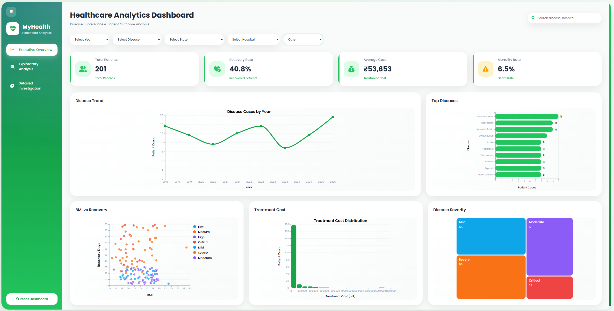
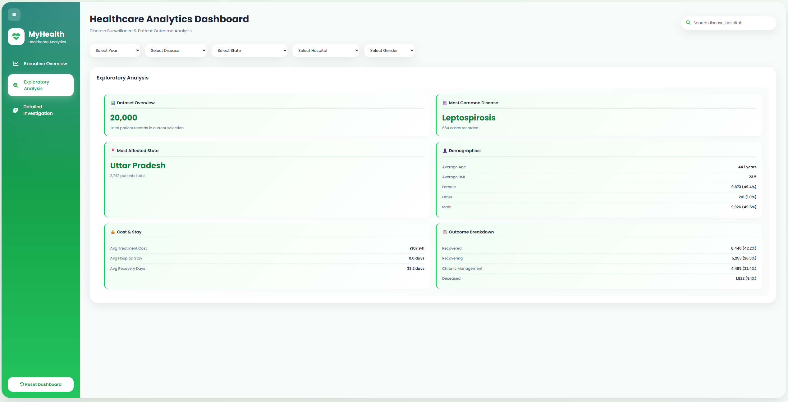
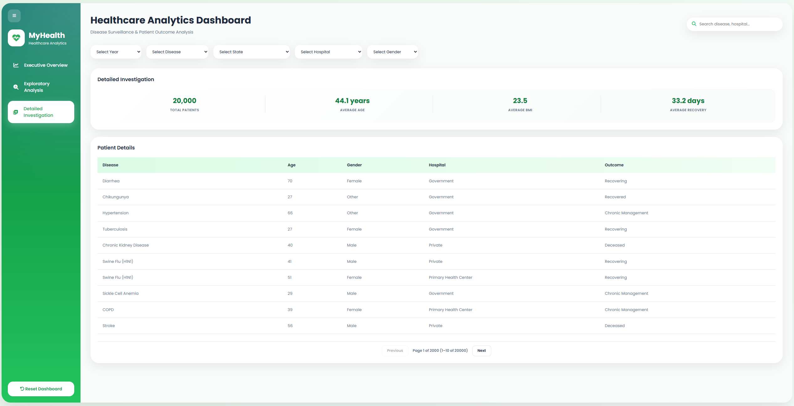

# MyHealth - Healthcare Analytics Dashboard

An interactive healthcare analytics dashboard built with **D3.js** to visualize patient records, disease trends, treatment outcomes, and hospital performance. The dashboard enables healthcare administrators and analysts to explore healthcare data through interactive charts, coordinated filtering, and detailed patient information.

---

## Overview

MyHealth is a web-based healthcare analytics dashboard developed as part of a **Data Visualization** project. It transforms raw healthcare data into meaningful insights through interactive visualizations, helping users identify disease patterns, analyze treatment costs, monitor patient recovery, and evaluate healthcare performance.

The dashboard follows a **three-level analytical workflow**:

- **Executive Overview** – High-level healthcare indicators and trends.
- **Exploratory Analysis** – Interactive visualizations for pattern discovery.
- **Detailed Investigation** – Patient-level information and detailed analysis.

---

## Features

### Executive Overview
- 📊 KPI Cards
- 📈 Disease Trend Line Chart
- 📊 Top Diseases Bar Chart

### Exploratory Analysis
- 🔵 BMI vs Recovery Days Scatter Plot
- 📉 Treatment Cost Histogram
- 🟩 Disease Severity Treemap

### Detailed Investigation
- 📋 Patient Summary Panel
- 📄 Interactive Patient Table

### Interactive Dashboard Features
- Dynamic filtering
- Search functionality
- Coordinated multiple views
- Interactive tooltips
- Animated chart transitions
- Responsive dashboard layout
- Drill-down analysis

---

## Dataset

**Dataset:** Indian Patient Disease & Treatment Dataset

### Dataset Information

| Attribute | Value |
|-----------|-------|
| Records | 20,000+ |
| Features | 32 |
| Data Type | Healthcare |
| Years Covered | 2018 – 2025 |

The dataset includes information such as:

- Patient demographics
- Disease diagnosis
- Hospital information
- Admission and discharge dates
- Treatment cost
- Recovery days
- Disease severity
- Medical outcomes
- Lifestyle factors

---

## Tech Stack

### Frontend
- HTML5
- CSS3
- JavaScript (ES6)

### Data Visualization
- D3.js v7

---

## Dashboard Preview

### Executive Overview

### Exploratory Analysis

### Detailed Investigation

---

## Visualizations

| Visualization | Purpose |
|--------------|---------|
| KPI Cards | Display important healthcare indicators |
| Line Chart | Analyze disease trends over time |
| Bar Chart | Compare the most common diseases |
| Scatter Plot | Explore BMI and recovery relationships |
| Histogram | Understand treatment cost distribution |
| Treemap | Visualize disease severity composition |
| Patient Table | Display detailed patient records |

---

## Project Objectives

The dashboard aims to:

- Improve healthcare data exploration.
- Identify disease trends over time.
- Analyze treatment effectiveness.
- Monitor healthcare performance.
- Support data-driven healthcare decisions.

---

## Learning Outcomes

This project demonstrates knowledge in:

- Data Visualization
- Dashboard Design
- Information Visualization
- Interactive User Interfaces
- Data Preprocessing
- D3.js Development
- Responsive Web Design

---

## License

This project was developed for educational purposes as part of a university Data Visualization course.